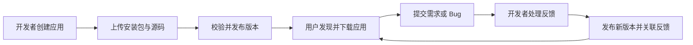

# HackerGazer

**让应用被发现，让迭代有迹可循。**

HackerGazer 是一个面向开发者与体验者的应用发布和观察平台。开发者可以展示作品、分发安装包、发布版本更新，并通过应用社区收集需求与 Bug；用户可以发现应用、了解维护记录、下载体验，并追踪自己的反馈在哪个版本得到处理。

项目从电脑端应用下载平台起步，先完成「发布 → 下载 → 反馈 → 迭代」的完整流程，再探索真实使用证据与投资人评估辅助能力。

> 当前状态：产品设计与开发准备阶段。本 README 根据《应用下载平台基础版产品需求文档》v1.1（2026-10-11）整理。下文的基础版能力为待实现范围；本仓库当前提供项目说明，尚未包含可运行的前后端代码。

## 为什么做 HackerGazer

一个应用的价值，需要通过实际体验和持续迭代被理解。HackerGazer 希望把作品介绍、可下载版本与用户反馈放在同一个地方，让开发者能够持续维护作品，让用户能够看见反馈的处理结果。

基础版优先解决三个问题：

- **发现与体验：** 在应用商场中找到作品，了解用途、运行环境和预览效果，获取对应安装包。
- **版本与维护：** 查看最新更新和完整历史记录，通过稳定链接访问具体版本。
- **反馈与改进：** 提交功能需求或 Bug，获得开发者回复，查看实现或修复对应的版本。

## 面向谁

| 角色 | 主要任务 |
| --- | --- |
| 体验者 | 浏览应用、下载安装包、评分、加入应用社区并提交反馈 |
| 开发者 | 发布自己的应用，上传安装包与源码，管理版本并处理反馈 |
| 平台管理员 | 开通开发者权限，管理应用与版本的可见性，处理违规内容 |

游客可以浏览公开内容、下载公开安装包与公开源码。评分和社区参与需要登录；发布能力由平台开通开发者权限。

## 基础版功能规划

| 模块 | 规划能力 |
| --- | --- |
| 应用商场 | 展示全部上架应用，支持名称搜索、Windows / macOS 筛选与分页 |
| 应用详情 | 展示简介、截图、开发者、评分、文件大小、下载数和最新更新；支持截图放大 |
| 发布工作台 | 创建应用资料与版本草稿，分别上传安装包和源码 ZIP，查看上传及校验状态 |
| 版本管理 | 发布正式版本，浏览版本历史与完整更新说明，复制版本链接，撤回问题版本 |
| 源码管理 | 每个版本关联一份源码 ZIP，开发者可设置公开或私有，并提供公开源码的许可或使用说明 |
| 应用社区 | 加入社区，提交功能需求或 Bug，开发者回复、引用版本并更新处理状态 |
| 基础管理 | 开通或停用开发者权限，下架应用、撤回版本、隐藏违规反馈或回复，并记录审计信息 |

平台通过电脑浏览器访问，基础版提供 Windows 与 macOS 应用的安装包下载。支持的系统与架构以具体版本的安装包为准，应用在用户电脑上安装和运行。

## 核心使用流程

### 发布应用

1. 开通开发者权限，创建应用并填写介绍、图标和预览截图。
2. 新建版本草稿，填写版本号、更新摘要和完整更新说明。
3. 分别上传对应系统与架构的安装包、该版本的源码 ZIP，选择源码公开或私有。
4. 等待文件校验完成，确认发布；首次发布后，应用进入商场。
5. 后续更新在同一个应用下创建新版本，保留历史记录。

### 体验应用

1. 在商场中浏览、搜索或按操作系统筛选应用。
2. 查看应用介绍、预览图片、评分与最新版本说明。
3. 选择适用的操作系统和架构，下载最新版本或仍可用的历史版本安装包。
4. 登录后可评分、加入应用社区，提交体验中的问题与建议。

### 追踪反馈

1. 用户提交功能需求或 Bug，说明使用场景、问题及所用版本。
2. 所属开发者回复，说明处理进展或暂缓原因。
3. 问题得到处理后，开发者发布新版本，并将反馈关联到该版本。
4. 用户点击版本引用，查看完整更新记录和对应安装包。

## 关键产品规则

- **安装包与源码分别管理。** 每个正式版本至少有一个校验通过的安装包和一份校验通过的源码 ZIP。开发者自行编译安装包，平台不自动构建或运行上传的源码。
- **源码权限按版本设置。** 源码默认私有，仅所属开发者和管理员可以访问；公开时需填写许可或使用说明。切换为私有后，停止新的公开下载。
- **发布记录保持稳定。** 版本号采用 `1.0.0` 形式，后续正式版本必须高于曾经发布过的最高版本；已发布文件不可覆盖，文件变更需要发布新版本。
- **反馈对应具体结果。** 标记“已实现”或“已修复”必须关联同一应用下已发布且未撤回的版本；回复中的版本引用使用稳定版本 ID。
- **撤回保留历史。** 撤回最新版本时回退到剩余有效版本；没有有效版本时，应用自动下架。历史记录和原有引用保留，撤回版本停止公开下载。
- **下载数与安装数分别展示。** 下载数统计成功签发凭证的安装包下载请求，按应用与匿名标识在北京时间同一天去重；源码下载单独记录。未接入安装回传时，安装数显示“暂无统计”。
- **权限由后端校验。** 草稿、私有源码和他人的发布工作台受访问控制，公开下载也需要检查应用、版本与文件状态。

## 页面规划

| 页面 | 主要内容 |
| --- | --- |
| 应用商场 | 应用卡片、搜索、系统筛选和分页 |
| 应用详情 | 应用介绍、预览、评分、下载和最新更新 |
| 版本历史 | 已发布版本列表与撤回状态 |
| 版本详情 | 完整更新说明、安装包、源码入口和关联反馈 |
| 应用社区 | 功能需求、Bug、开发者回复与处理状态 |
| 发布工作台 | 我的应用、资料编辑、文件上传和版本发布 |
| 登录页面 | 注册或登录，完成后返回原页面 |
| 基础管理 | 开发者权限、应用与版本处置、内容管理 |

## 开发协作

基础版按前端与后端分工，两位负责人共同维护接口契约并完成端到端验收。具体框架、数据库、对象存储与部署方案尚未确定。

| 分工 | 交付范围 |
| --- | --- |
| 前端 | 页面与路由、角色入口、搜索筛选、图片预览、下载选择、上传进度、版本记录、社区交互、错误恢复 |
| 后端 | 账号与对象权限、数据模型、查询接口、上传校验与文件服务、发布事务、下载授权与计数、评分、社区和审计 |
| 联合交付 | OpenAPI 契约、演示数据、真实接口联调、部署说明和核心场景验收 |

建议按以下顺序推进：

1. **M1 · 契约确认：** 固化字段、状态、权限、分页和错误码，准备账号与样例应用。
2. **M2 · 基础开发：** 前端完成页面与 Mock 交互，后端完成查询、账号和上传存储。
3. **M3 · 流程联调：** 打通上传发布到商场下载，再打通社区反馈到版本引用。
4. **M4 · 内测交付：** 完成权限、文件、失败恢复、计数和浏览器兼容性验收。

当前没有可执行的安装、启动或部署命令。代码落地后，将补充环境要求、配置示例、数据库初始化、运行及测试说明。

## 验收重点

- 发布同一应用的多个版本，商场、详情与下载文件始终对应正确版本。
- 安装包或源码缺失、校验未通过时不能发布；失败和重试不会产生重复版本。
- 私有源码、草稿与其他开发者的后台资料不会被越权访问。
- 下载历史文件、源码权限切换、撤回版本和最新版本回退符合预期。
- 评分修改不会重复计人数，安装包与源码下载的统计互不混用。
- 反馈可以被回复、关联处理版本，并通过稳定链接查看完整更新记录。

## 后续探索

完成基础版后，项目将结合真实使用与访谈继续验证两个方向：

| 方向 | 候选能力 |
| --- | --- |
| 数据检测与观察 | 围绕核心任务、使用结果、回访和团队迭代组织证据，记录来源、样本、版本与统计口径 |
| 投资人 Agent | 帮助关注早期 AI 应用 MVP 的投资人整理授权材料，复核已有判断，识别未知项并制定补充验证计划 |

这两个方向处于研究阶段，需求与价值仍待验证，不计入基础版交付。基础版也暂不包含支付订阅、排行榜、自动安装或更新、即时聊天、Git 仓库托管及源码自动构建。

## 参与项目

欢迎通过 [Issues](https://github.com/monoy-ni/HackerGazer/issues) 提出产品建议、讨论接口与实现方案。报告问题时，请提供使用场景、复现步骤、预期结果、实际结果以及相关版本信息。
